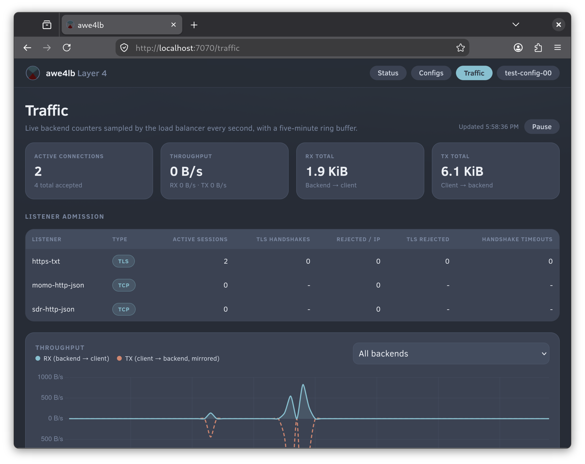

# awe4lb

`awe4lb` is a lightweight, high-performance Layer 4 (TCP/UDP) load balancer written in Java.



It supports TLS termination, backend selection via various algorithms (e.g., round-robin, weighted, IP hash, least
connections), dynamic discovery (HTTP, exec, Kubernetes), health checks, and UDP proxying. Configurations use a simple
JSON-based DSL for defining servers, matching rules, pools, and discovery mechanisms.

It includes a web-based UI for management and an API for runtime operations.

## Purpose

Incoming TCP/UDP traffic gets distributed across backend servers to improve scalability, reliability, and performance.
Key use cases include:

- TLS-termination proxies for HTTP services.
- Load balancing for databases, APIs, or custom protocols.
- UDP forwarding (e.g., for echo servers or custom apps).
- Dynamic backend discovery in environments like Kubernetes.

It prioritizes simplicity, low overhead, and extensibility while handling production workloads.

## Features

- **Protocols**: TCP (with TLS), UDP.
- **Balancing Algorithms**: Random, weighted, round-robin, IP hash, least connections.
- **Discovery**: Static hosts, HTTP endpoints, external commands, Kubernetes API.
- **Health Checks**: Built-in TCP connect checks, plus exec-based checks (e.g., ping, nc) with configurable
  intervals/timeouts.
- **Management**: REST API for config CRUD/select, web UI with a bidirectional YAML/form config editor.
- **Metrics**: Per-backend RX/TX totals, throughput rates, connection counts and a server-side five-minute history ring
  buffer.

## Quick Start

Grab the [latest release](https://github.com/vaccovecrana/awe4lb/releases)
or [docker image](https://github.com/vaccovecrana/awe4lb/pkgs/container/awe4lb)

Run the load balancer:

```shell
a4lb --api-host=127.0.0.1 --config=./path/to/configs/directory
```

The API/UI has no authentication. Keep it on localhost, a VPN, or behind an authenticated reverse proxy. Use an SSH
tunnel to reach a localhost-bound UI from another machine:

```shell
ssh -L 7070:127.0.0.1:7070 user@a4lb-host
```

Or from a Docker image:

```shell
docker run -d --name awe4lb \
  -p 127.0.0.1:7070:7070 -p 8070:8070/udp -p 443:8443 \
  -v $(pwd)/configs:/etc/a4lb \
  ghcr.io/vaccovecrana/awe4lb:1.0.0 \
  --api-host=0.0.0.0 --log-level=info --config=/etc/a4lb
```

> Note: in both cases, the user executing `a4lb` must be able to open any ports that will be used for front-end load
> balancing (i.e. port `443/tcp` for TLS termination, port `22/tcp` for SSH proxying, or any other services you define).

Open `http://localhost:7070` in a browser for config management.

### Web UI

The Preact UI is bundled with rspack and provides three views:

- **Status**: the active configuration, its servers, matches, TLS/UDP settings, discovery, health checks and live
  backend state.
- **Configs**: create, edit, activate, stop and delete configurations. The editor keeps a structured form and a YAML
  document in sync in both directions, reports YAML syntax errors with line/column information, and surfaces backend
  validation errors inline. `Ctrl/Cmd+S` saves.
- **Traffic**: live listener admission counters (active sessions, per-IP rejections, TLS handshake rejections and
  timeouts), plus per-backend RX/TX throughput charts and counters, rendered from a server-side ring buffer sampled
  once per second.

The REST API also exposes the raw snapshot at `GET /api/v1/stats`. For TCP listeners the snapshot includes active
connections, per-IP rejections, TLS handshake rejections, and handshake timeouts.

Using the UI, you can define load balancer configurations. In this example, we have 3 front servers. The first proxying
HTTP connections, the second terminating HTTPS connections to HTTP backends, and the third proxying UDP connections via
sticky sessions.

```yaml
id: test-config-00
description: Test configuration
servers:
  - id: test-http
    addr: {host: 0.0.0.0, port: 80}
    pool:
      hosts: [{addr: {host: 172.16.4.58, port: 3000}}]
    healthCheck: {intervalMs: 60000, timeoutMs: 15000}
  - id: test-https
    addr: {host: 0.0.0.0, port: 443}
    match:
      - op: {sni: {equals: test-svc0.localhost}}
        pool:
          hosts: [{addr: {host: 172.16.4.59, port: 3000}}]
      - op: {sni: {equals: test-svc1.localhost}}
        pool:
          hosts: [{addr: {host: 172.16.4.58, port: 3000}}]
        healthCheck:
          exec: {command: nc, args: ['-z', '-v', $host, $port]}
    tls:
      ciphers: [TLS_AES_128_GCM_SHA256]
      base:
        certPath: ./src/test/resources/certs/awe4lb.pem
        keyPath: ./src/test/resources/certs/awe4lb.key
  - id: test-udp-echo
    addr: {host: 0.0.0.0, port: 8070}
    match:
      - pool:
          type: ipHash
          hosts: [{addr: {host: 127.0.0.1, port: 6000}}]
        healthCheck:
          exec: {command: ping, args: ['-c', '1', $host]}
    udp:
      bufferSize: 2048
      idleTimeoutMs: 2000
      maxSessions: 1024
```

For in-depth configuration options, [read the docs](https://vaccovecrana.github.io/awe4lb).

For an in-depth example load balancing configuration,
see [test-config-00](./a4-test/src/test/resources/test-config-00.json).

## Configuration notes

- TCP buffer sizes are currently determined by the Operating System.
- UDP buffer sizes are application specific. Default is 16384 bytes.

### Health checks on bare-metal hosts

TCP backends get a built-in health check when no explicit `exec` check is configured. It opens a TCP connection to the
backend, so it needs no external commands, packages, or capabilities and works with the hardened systemd unit.
It checks reachability of the port, not HTTP/application health, and does not perform a TLS handshake or validate
backend certificates.

Exec-based health checks and discovery commands have additional host requirements:

- Use absolute command paths (for example `/usr/bin/nc` instead of `nc`) and install the corresponding packages.
  Minimal hosts often lack `ping`, `nc`, or `curl`.
- The systemd unit sets a deterministic `PATH`, but relative file arguments resolve under `WorkingDirectory=/etc/a4lb`.
  Use absolute paths for certificate files, discovery inputs, and scripts.
- `ping` needs raw ICMP (`CAP_NET_RAW`) unless unprivileged ping is enabled for the service group via
  `net.ipv4.ping_group_range`. The reference unit intentionally grants neither, so a `ping` health check will fail
  under it by default. Adding `CAP_NET_RAW` materially increases the service's privileges; prefer a TCP check or a
  protocol-aware probe instead.
- `ping` only proves host reachability. It does **not** verify the backend UDP port or application; a dead UDP service
  can still appear `Up`.
- UDP backends without a health check are marked `Up` and participate in routing without verification.
- The default interval/timeout is 5000/2500 ms, and `timeoutMs` must be less than `intervalMs`. Exec checks spawn a
  process on every interval, so avoid very short intervals with many backends.
- Docker runs as root by default and retains `CAP_NET_RAW`, so `ping` may work there even though the non-root systemd
  deployment cannot use it. Test health checks against the actual deployment model.

### UDP session lifetime

UDP forwarding is sticky per client address and port. The first datagram selects a backend and creates a session;
subsequent datagrams from the same client keep using that backend until the session is removed.

`idleTimeoutMs` is a sliding timeout: any datagram from the client or the backend refreshes the session's expiry. A
session is removed after that much traffic-free time, when `maxSessions` is exceeded, when an I/O error occurs, or when
its backend is marked `Down` by an explicit health check. Sessions are not rebalanced merely because a backend's state
changes from `Unknown` to `Up`; they are only closed on an explicit `Down` transition.

UDP matches without a health check are still marked `Up` and participate in routing. That state is effectively
unchecked: the UI shows `Up`, and there is no separate "unchecked" state. Use an explicit `exec` health check when the
backend can provide a meaningful probe.

### TCP admission limits

TCP listeners support per-source-IP admission limits and TLS handshake protection:

```yaml
tcp:
  maxConnectionsPerIp: 512
  tlsHandshakeTimeoutMs: 5000
  maxTlsHandshakes: 256
```

- `maxConnectionsPerIp` is enforced per listener and per client IP. It is not a process-wide limit.
- `tlsHandshakeTimeoutMs` applies while the server is waiting for the client's TLS handshake.
- `maxTlsHandshakes` caps concurrent in-progress TLS handshakes **per listener**, not per client IP. A single source
  can occupy all handshake slots until the timeout expires.
- The limits are checked before the per-connection buffers are allocated.
- Rejections are counted and logged at a rate-limited frequency.

The defaults are conservative starting points, not universal values. Tune them for the workload, expected client
concurrency, and NAT topology. In particular, `maxConnectionsPerIp` may need to be raised for carriers, VPN concentrators,
or other NAT-heavy deployments, and TLS handshake limits should be sized to the listener's CPU capacity.

Established TCP sessions deliberately have **no idle or maximum-lifetime timeout**. Long-lived protocols can pause
between bursts (for example, a video client buffering playback) without being disconnected by a4lb.

## Security considerations

**The management API/UI has no authentication or authorization.** Anyone who can reach the API port has full control:
they can create, edit, activate, and stop configurations, inspect traffic and backend state, and trigger the
discovery/health-check commands configured in those configurations. Treat the API port as a privileged administrative
interface, not as a public web endpoint.

- Bind the API to `127.0.0.1` by default. Use an SSH tunnel, a trusted WireGuard network, or an authenticated reverse
  proxy for remote access.
- Never publish port `7070` to the public internet. Docker's `-p 7070:7070` publishes on **all** interfaces; use
  `-p 127.0.0.1:7070:7070` unless the host is already isolated behind a trusted network boundary.
- Discovery and health-check commands run as the service account with access to the host network. A compromised UI is
  therefore not just a configuration leak: it can be used to probe or attack reachable networks. Restrict egress with
  host firewall rules if the load balancer does not need broad network access.
- Prefer the non-root systemd deployment. It limits host compromise, but it does **not** make the API harmless: the
  service still controls traffic, TLS keys/certificates, configuration persistence, and any networks reachable from the
  host. Do not run it with extra groups, `sudo`, the Docker socket, or other privilege-escalation paths.
- Running as root is an operator choice for environments where low-port privileges cannot be delegated. In that case a
  service compromise is a host compromise; document and accept that risk explicitly.
- The management API does not provide request-rate limiting. Front-end listeners support per-client-IP connection
  limits and listener-wide TLS handshake caps, but there is no per-source accept-rate token bucket or per-IP handshake
  limit. Put the API behind an external proxy/firewall when exposed beyond localhost, and monitor connection and
  file-descriptor usage.
- Most applications and use cases should work fine with the default TCP buffer size. However, applications which stream
  large amounts of data should make sure that the underlying hardware has enough memory capacity to handle backpressure
  from either clients or backends.

## Production deployment

### Configuration file semantics

`--config` accepts either a directory or a file:

- **Directory**: starts the API/UI with no active configuration. Select one in the UI.
- **File**: starts the API/UI and activates that file as the boot configuration.

The API/UI is always opened first. If a startup file is invalid or fails to bind, the error is logged and the UI remains
available so an operator can fix the config, stop the active config, or select another one. A missing `--config` path is
rejected at startup.

Runtime changes are intentionally **not** persisted as the boot selection. Selecting another configuration or stopping
the active one affects the current process only; the next service restart activates the `--config` file again. Editing
that same configuration persists normally.

Prefer either a boot file whose filename matches its config id, or a symlink:

```shell
ln -s /etc/a4lb/production.json /etc/a4lb/active.json
```

With this layout, `--config=/etc/a4lb/active.json` always loads `production.json`, UI saves still write
`production.json`, and changing the symlink changes the boot configuration.

### systemd

The reference unit runs as a dedicated non-root `a4lb` user and grants only `CAP_NET_BIND_SERVICE` for low ports. From
a checkout, the setup script creates the user/group, installs the binary and unit, prepares `/etc/a4lb`, optionally
installs a boot configuration, and enables the service:

```shell
sudo bash a4-lb/setup.sh --binary ./a4lb-linux-amd64 --config ./production.json
```

Without `--binary`, the script uses the local native build when present, otherwise it downloads the latest release
binary and verifies its checksum when available. Without `--config`, it creates an empty `/etc/a4lb/active.json`
placeholder so the UI can start and an operator can create the first configuration there.

`--config FILE` copies the file into `/etc/a4lb` and points `active.json` at it. Keep the filename equal to the
configuration id, or use the symlink layout described above, so UI saves and the boot file stay in sync.

Manual equivalent:

```shell
sudo groupadd --system awe4lb
sudo useradd --system --gid awe4lb --home-dir /etc/a4lb --shell /usr/sbin/nologin awe4lb
sudo install -d -o awe4lb -g awe4lb -m 0750 /etc/a4lb
sudo install -m 0755 a4lb-linux-amd64 /usr/local/bin/a4lb
sudo install -m 0644 a4-lb/a4lb.service /etc/systemd/system/a4lb.service
sudo -u awe4lb ln -s /etc/a4lb/production.json /etc/a4lb/active.json
sudo systemctl daemon-reload
sudo systemctl enable --now a4lb
```

The unit binds the API/UI to `127.0.0.1:7070`, runs as `a4lb`, grants only `CAP_NET_BIND_SERVICE` for low ports, and
keeps `/etc/a4lb` writable for the config editor. Use an SSH tunnel or authenticated reverse proxy for remote UI access.
`ProtectHome=true` means certificates and command inputs must live outside `/home`; keep them in `/etc/a4lb` or another
system path readable by the service account. Private keys should be owned by `a4lb:a4lb` and not world-readable (for
example mode `0640`); the unit's `UMask=0027` applies to files the service creates. The unit sets a deterministic
`PATH` for exec-based discovery/health commands, but absolute command paths in configurations are still preferred.

### Docker

The image keeps the busybox applets so exec-based discovery and health checks work, and includes a `wget` health check.
It runs as root in the container and retains default network capabilities, so `ping` behavior differs from the
non-root systemd unit. Publish the proxy ports your configuration uses, and keep the management port on localhost:

```shell
docker run -d --name awe4lb \
  -p 127.0.0.1:7070:7070 -p 8070:8070/udp -p 443:8443 \
  -v $(pwd)/configs:/etc/a4lb \
  ghcr.io/vaccovecrana/awe4lb:1.0.0 \
  --api-host=0.0.0.0 --log-level=info --config=/etc/a4lb/active.json
```

The container needs `--api-host=0.0.0.0` to be reachable through Docker's published port; the `127.0.0.1` in the
`-p` mapping is what keeps it local to the host. Do not change that mapping to a public interface unless the host is
already behind a trusted, authenticated boundary.

The native release binary is dynamically linked against glibc and `libz`; install those on the host if they are not
already present.

## Development

Use the Gradle wrapper (Gradle 9.6) and JDK 21+.

Then run:

```
./gradlew clean build
```

The UI toolchain (Node 22.17, rspack, Sass) is provisioned by the Gradle node plugin.

Tests:

```
./gradlew build                 # compiles everything, runs Java + UI unit tests
npm --prefix a4-ui run test:unit
./gradlew :a4-ui:testUi         # UI unit tests only
./gradlew :a4-test:test         # Java unit + proxy/stats tests
```

The docker-compose dependent Java suite is opt-in:

```
./a4-test/e2e.sh
```

Browser suites run against a live instance and are opt-in as well. The
convenience runner starts a throwaway API/UI instance in the background and
stops it afterwards:

```shell
./a4-ui/test/run-suite.sh e2e
./a4-ui/test/run-suite.sh visual
```

Or point the suites at an instance you already started:

```shell
# Terminal 1
a4lb --config=./configs --api-port=7070

# Terminal 2
A4_UI_URL=http://127.0.0.1:7070 ./gradlew :a4-ui:e2eTest
A4_UI_URL=http://127.0.0.1:7070 ./gradlew :a4-ui:visual
```

`e2eTest` runs the Puppeteer suite; `visual` captures desktop and mobile
screenshots into `a4-ui/build/test-artifacts/visual/`. Set `A4_CHROME` if the
browser is not on the default path.

## Similar projects

- https://www.envoyproxy.io/
- https://gost.run/
- https://github.com/yyyar/gobetween

## Resources

- https://docs.oracle.com/en/java/javase/11/docs/specs/security/standard-names.html#jsse-cipher-suite-names
- https://stackoverflow.com/questions/53323855/sslserversocket-and-certificate-setup
- https://stackoverflow.com/a/62263402/491160
- https://github.com/raell2/SSLAsynchronousSocketChannel/tree/master
- https://stackoverflow.com/questions/14225957/socket-vs-socketchannel
- https://bugs.openjdk.org/browse/JDK-8202625
- https://github.com/yyyar/gobetween/issues/335
- https://github.com/felipejfc/go-udp-echo-server

## FBC - INTRODUCTION TO PARANATURAL TOPICS

> Presentation 27.1
> Presented by: Dr. Casper Darling
> Research assistance provided by: Carla Vaughn, Hubert Tan

Hello there! I'm Dr. Casper Darling, head of research at the Federal Bureau of Control.

Now, listen closely, because what we have here with `awe4lb` is nothing short of remarkable.

It's a load balancer, yes, but think of it as a Control Point in the digital realm—routing TCP and UDP traffic through
sockets that act like our very own Thresholds!

These altered streams of data, infused with the energies of everyday networks, are balanced across backends with
algorithms as precise as binding an Object of Power.

We've got discovery methods pulling from HTTP, commands, even Kubernetes—containing the chaos, keeping it stable.

But remember, every connection could be an intrusion, a potential AWE waiting to unfold.

As for me, well... I've been exposed to something profound, a resonance that's changing everything. This is my final
presentation on the matter.

Use `awe4lb` wisely; the Bureau's depending on it.

---

In memory of James Perry McCaffrey (March 27, 1958 – December 17, 2023).
